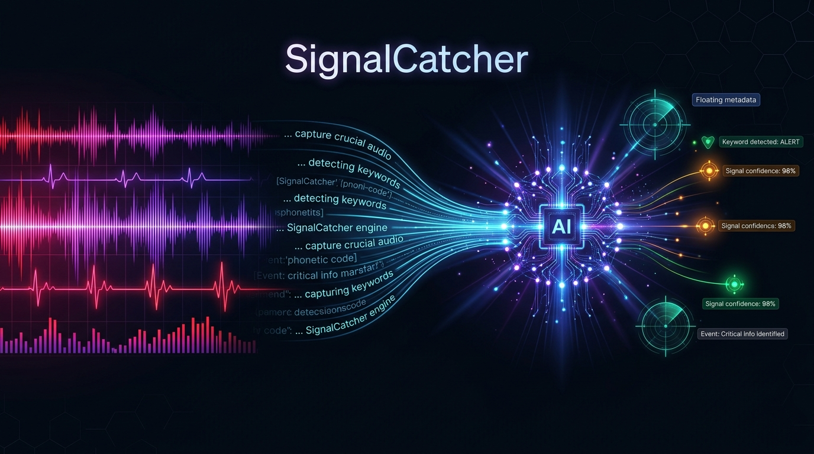
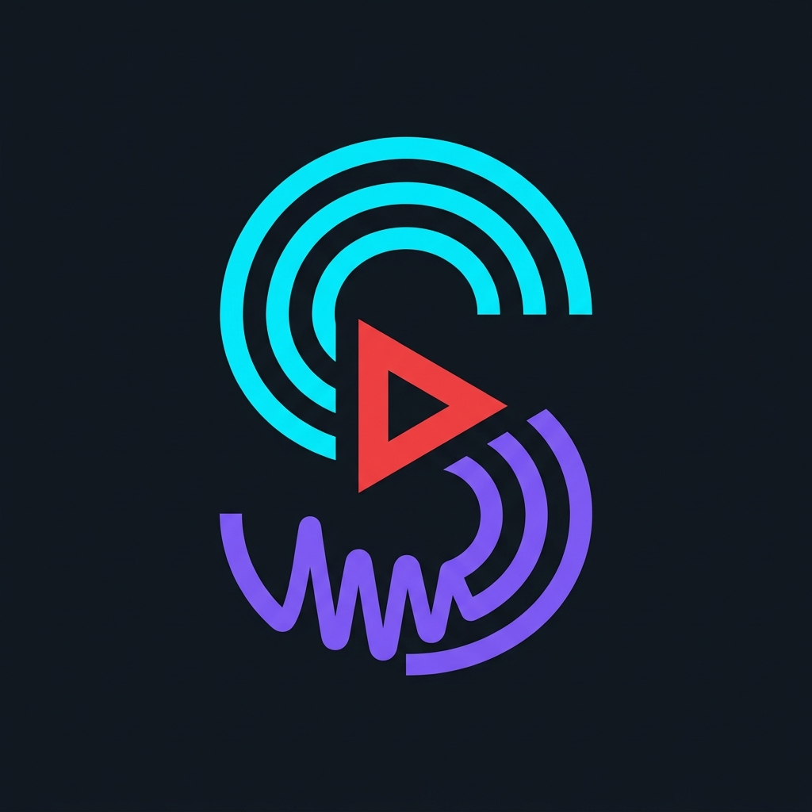
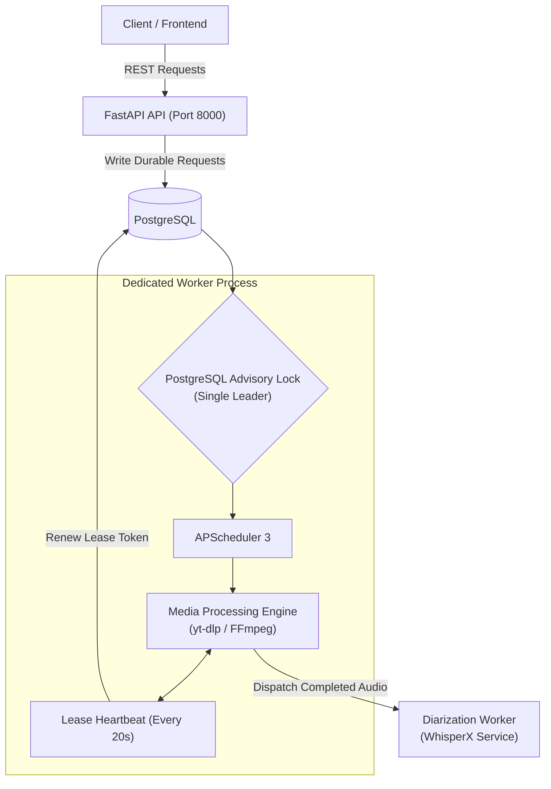
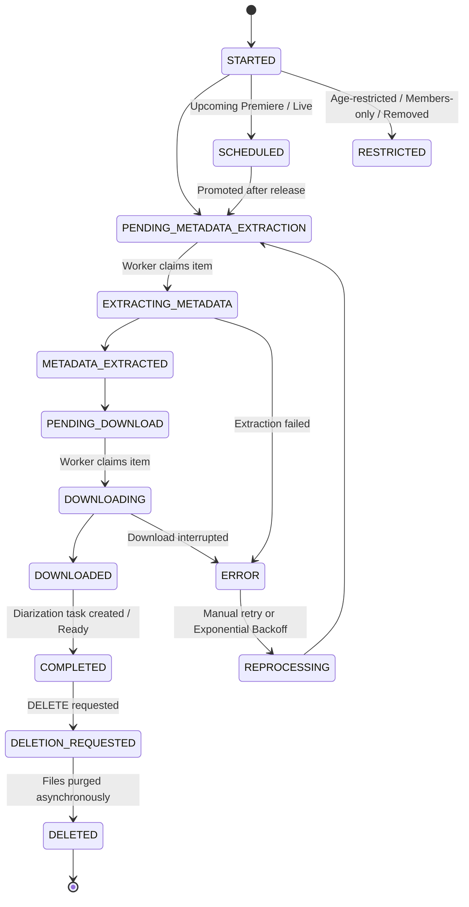

<p align="center">
  
</p>

<p align="center">
  <a href="https://www.python.org/"></a>
  <a href="https://fastapi.tiangolo.com/"></a>
  <a href="https://www.postgresql.org/"></a>
  <a href="https://docs.astral.sh/uv/"></a>
  <a href="https://github.com/yt-dlp/yt-dlp"></a>
  <a href="https://docs.docker.com/"></a>
</p>

---

<p align="center">
  
</p>

<h1 align="center">SignalCatcher</h1>

<p align="center">
  <strong>Automated Video Capture, Speech Transcription, Speaker Diarization & Audio Signal Intelligence</strong>
</p>

**SignalCatcher** is an automated video capture, speech transcription, speaker diarization, and content intelligence platform. It continuously monitors YouTube channels and playlists, extracts metadata, downloads high-fidelity media, and coordinates downstream AI processing (such as speech-to-text and WhisperX diarization).

Engineered with **FastAPI**, **SQLAlchemy 2.0**, **PostgreSQL**, **APScheduler**, and **yt-dlp**, SignalCatcher uses an enterprise-grade concurrency model featuring PostgreSQL advisory locks, lease-based task reservations, and resilient exponential backoff recovery.

---

## 📑 Table of Contents

- [Key Features](#-key-features)
- [Architecture & Design](#-architecture--design)
  - [Clean Architecture & Module Layout](#clean-architecture--module-layout)
  - [Distributed Concurrency & Locking](#distributed-concurrency--locking)
- [Content Lifecycle & State Machine](#-content-lifecycle--state-machine)
- [Getting Started](#-getting-started)
  - [Prerequisites](#prerequisites)
  - [Local Installation with uv](#local-installation-with-uv)
  - [Running the Application](#running-the-application)
- [Docker & Production Deployment](#-docker--production-deployment)
- [Scheduled Worker Jobs](#-scheduled-worker-jobs)
- [API Reference](#-api-reference)
- [Configuration Reference](#-configuration-reference)
- [Maintenance CLI & Diagnostics](#-maintenance-cli--diagnostics)
- [Code Quality & Testing](#-code-quality--testing)
- [Frontend Integration](#-frontend-integration)
- [License](#-license)

---

## ✨ Key Features

- **Automated YouTube Monitoring:** Track channels and playlists with configurable polling schedules via yt-dlp.
- **Robust Two-Process Architecture:** Independent, horizontally-scalable FastAPI REST API and a dedicated APScheduler background worker.
- **Fault-Tolerant Media Processing:** Lease-based content reservations (`SELECT FOR UPDATE SKIP LOCKED`), automatic renewal heartbeats, and safe recovery of interrupted downloads.
- **AI Diarization & Transcription Pipeline:** Dispatches completed media to WhisperX-powered diarization workers for speech transcription and speaker identification.
- **Resilient Error Classification:** Automatic detection of age restrictions, members-only content, private videos, and copyright notices with exponential backoff retries.
- **Safe Asynchronous Deletion:** Path-confined file purging that guarantees zero filesystem leaks while keeping records consistent.
- **Full Operational Telemetry:** Built-in health checks (`/status`, `/ready`), detailed queue metrics (`/metrics`), and transition audits.

---

## 🏗️ Architecture & Design

### Clean Architecture & Module Layout

SignalCatcher strictly implements **Clean Architecture (DDD)** principles. Business rules remain completely isolated from databases, HTTP frameworks, and external tools:

```
src/
├── core/                        # Cross-cutting concerns (config, db, telemetry, logging)
│   ├── config/                  # Pydantic Settings and environment validation
│   ├── database/                # SQLAlchemy session & engine lifecycle management
│   └── telemetry/               # Metrics collection and health monitors
└── modules/
    ├── youtube/                 # YouTube ingestion, metadata & download module
    │   ├── domain/              # Entities, value objects, domain enums & repository interfaces
    │   ├── application/         # Use cases, DTOs, orchestrators, and mappers
    │   ├── infrastructure/      # Concrete SQLAlchemy repos, yt-dlp adapters, notifications
    │   └── presentation/        # FastAPI routers, request schemas & APScheduler definitions
    └── diarization/             # Speaker diarization & AI transcription module
        ├── domain/              # Task entities, states, and interfaces
        ├── application/         # Dispatchers, retry handlers, status sync
        ├── infrastructure/      # HTTP client to WhisperX worker, task repositories
        └── presentation/        # FastAPI diarization endpoints
```

### Distributed Concurrency & Locking

> [!IMPORTANT]
> The API **never** starts an in-process scheduler or processes media work with FastAPI `BackgroundTasks`. The API and the worker run as separate OS processes.



1. **Advisory Lock Leader Election:** An exclusive PostgreSQL advisory lock (`pg_try_advisory_lock`) ensures that exactly one scheduler worker is active per database. Multiple API processes can scale horizontally.
2. **Lease Reservations:** Content is reserved using `SELECT FOR UPDATE SKIP LOCKED`. Every reservation receives a cryptographically unique token and expiration timestamp, renewed every 20 seconds during processing.
3. **Optimistic Validation:** Final updates check token ownership and expiration, preventing stale workers from overwriting newer reservations.
4. **Transaction Safety:** External network calls (YouTube scraping, video downloads, AI dispatch) strictly execute outside database transactions.

---

## 🔄 Content Lifecycle & State Machine

Every ingested video progresses through a deterministic, auditable state machine:



### Fault Recovery & Backoff

- **Orphan Cleanup:** The worker checks reservations every 30 seconds. Expired leases without active heartbeats are immediately reset to pending.
- **Partial Downloads:** Interrupted downloads in `nopart` mode are detected and cleanly replaced on subsequent attempts.
- **Exponential Backoff:** Failures trigger backoff starting at 300 seconds up to 86,400 seconds (24 hours), with a hard limit of 5 automatic retry attempts per cycle.
- **Restricted Classifications:** Videos with special restrictions are classified into terminal or dormant states (`MEMBERS_ONLY`, `AGE_RESTRICTED`, `PRIVATE_VIDEO`, `COPYRIGHT_REMOVED`, `ACCOUNT_TERMINATED`, `VIDEO_REMOVED`, `COURT_ORDER`).

---

## 🚀 Getting Started

### Prerequisites

- **Python:** 3.10 or newer (3.12 recommended)
- **uv:** Ultra-fast Python package installer (`pip install uv` or `curl -LsSf https://astral.sh/uv/install.sh | sh`)
- **PostgreSQL:** 14+ with an empty database created
- **FFmpeg:** Installed and accessible on your system `PATH`

### Local Installation with `uv`

1. **Clone the repository:**
   ```sh
   git clone https://github.com/your-org/SignalCatcher.git
   cd SignalCatcher
   ```

2. **Configure environment variables:**
   ```sh
   cp .env.example .env
   ```
   Edit `.env` and configure your database and download path:
   ```dotenv
   POSTGRES_USER=postgres
   POSTGRES_PASSWORD=your_secure_password
   POSTGRES_HOST=localhost
   POSTGRES_PORT=5432
   POSTGRES_DATABASE=signalcatcher
   DOWNLOAD_YOUTUBE_PATH=./youtube
   ```

3. **Install dependencies and run migrations:**
   ```sh
   uv sync --frozen
   uv run alembic upgrade head
   ```

### Running the Application

Start the worker and API in separate terminal tabs:

**Terminal 1 — Dedicated Worker:**
```sh
uv run python worker.py
```

**Terminal 2 — FastAPI Web Server:**
```sh
uv run uvicorn main:app --host 127.0.0.1 --port 8000 --reload
```

- **Interactive API Documentation:** Available at [http://127.0.0.1:8000/docs](http://127.0.0.1:8000/docs) (Swagger UI) and `/redoc`.
- **Readiness Check:** [http://127.0.0.1:8000/ready](http://127.0.0.1:8000/ready) validates database connectivity and worker heartbeat (returns `503 Service Unavailable` if the worker is down).

---

## 🐳 Docker & Production Deployment

SignalCatcher provides production-ready Docker Compose configurations.

### Standard Multi-Service Stack

The stack separates migrations, API, and worker into distinct containers:

```sh
docker compose up --build -d
```

| Service | Role | Ports / Healthcheck |
| :--- | :--- | :--- |
| `migrate` | One-shot Alembic migration runner | Runs before API and worker start |
| `app` | Scalable FastAPI application server | Exposed on port `5001` (internal `8000`) |
| `worker` | Scheduler and media extraction runner | Healthcheck verifies heartbeat timestamp in PostgreSQL |

### Raspberry Pi / Host Volume Mounts

In storage-heavy environments (e.g., Raspberry Pi host with external SSD), media paths are mounted consistently:
```yaml
volumes:
  - /media/eriberry/SSD_1/youtube:/youtube
```
Ensure the downloads folder is writable by container user `UID:GID 1000:1000`.

### Local Full-Stack Overlay (Backend + Frontend)

To spin up the API and the React frontend simultaneously:
```sh
docker compose -f docker-compose.yml -f docker-compose.local.yml up --build -d
```
Access the web frontend at `http://localhost:3000` and the API at `http://localhost:8000`.

---

## ⏱️ Scheduled Worker Jobs

APScheduler manages background jobs with isolated execution lanes:

| Job ID | Frequency | Description |
| :--- | :--- | :--- |
| `youtube_monitor_channels` | Every 30 min | Discovers new videos from monitored channels |
| `youtube_extract_and_download` | Every 15 min | Processes metadata queue followed by pending downloads |
| `youtube_process_errors` | Every 30 min | Evaluates backoff timers and re-queues eligible errors |
| `youtube_promote_scheduled` | Every 30 min | Promotes released premieres and livestreams to download |
| `youtube_delete_contents` | Every 1 min | Asynchronously removes filesystem assets for deleted media |
| `youtube_extract_metadata` | Manual / Trigger | On-demand metadata extraction lane |
| `youtube_download_videos` | Manual / Trigger | On-demand video download lane |

To manually trigger any job via the API:
```sh
curl -X POST http://localhost:8000/api/youtube/scheduler/jobs/youtube_extract_and_download/run
```

---

## 🔌 API Reference

### Health & Telemetry

| Method | Endpoint | Description |
| :--- | :--- | :--- |
| `GET` | `/status` | Basic API liveness check |
| `GET` | `/ready` | Deep readiness check: DB connectivity and fresh worker heartbeat |
| `GET` | `/metrics` | Operational JSON telemetry (queue sizes, retry counts, job runtimes) |

### YouTube Content & Channels

| Method | Endpoint | Description |
| :--- | :--- | :--- |
| `GET` | `/api/youtube/channels` | Retrieve all registered YouTube channels |
| `POST` | `/api/youtube/monitored_channels` | Register a new channel for automated polling |
| `GET` | `/api/youtube/monitored_channels` | List all monitored channels and active schedules |
| `PATCH` | `/api/youtube/monitored_channels/{id}/status` | Enable or pause channel monitoring |
| `POST` | `/api/youtube/content` | Ingest a single video by URL / ID |
| `GET` | `/api/youtube/content` | List paginated media with filters, status, and metadata |
| `POST` | `/api/youtube/playlist` | Ingest all videos from a YouTube playlist |
| `GET` | `/api/youtube/content/status-count` | Aggregate count of videos per pipeline state |
| `GET` | `/api/youtube/content/{external_id}/tracking` | Detailed state transition audit trail |
| `POST` | `/api/youtube/content/{external_id}/retry` | Force manual retry of a failed video |
| `POST` | `/api/youtube/content/retry-errors` | Batch-queue retries for all eligible errors |
| `DELETE` | `/api/youtube/content/{external_id}` | Request asynchronous physical file deletion |

### Diarization & Speech Intelligence

| Method | Endpoint | Description |
| :--- | :--- | :--- |
| `POST` | `/api/diarization/youtube/{external_id}` | Create an AI speaker diarization task for completed content |
| `GET` | `/api/diarization/list` | List diarization tasks with status and progress |
| `POST` | `/api/diarization/{id}/reprocess` | Requeue an interrupted or failed diarization task |
| `POST` | `/api/diarization/{id}/cancel` | Cancel an in-flight diarization task |

---

## ⚙️ Configuration Reference

All settings are configured via environment variables and validated through Pydantic Settings (`src/core/config/settings.py`):

| Variable | Default | Purpose |
| :--- | :--- | :--- |
| `POSTGRES_USER` | *Required* | Database user username |
| `POSTGRES_PASSWORD` | *Required* | Database password |
| `POSTGRES_HOST` | `localhost` | PostgreSQL host address |
| `POSTGRES_PORT` | `5432` | PostgreSQL port |
| `POSTGRES_DATABASE` | `signalcatcher` | Database name |
| `DOWNLOAD_YOUTUBE_PATH` | *Required* | Local or mounted filesystem root for media downloads |
| `CORS_ALLOWED_ORIGINS` | `http://localhost:3000,http://localhost:5173` | Allowed CORS origins for browser clients |
| `PROCESSING_LEASE_SECONDS`| `300` | Lease duration before an unrenewed reservation expires |
| `MAX_PROCESSING_ATTEMPTS` | `5` | Maximum retry attempts per item before requiring manual intervention |
| `RETRY_BASE_SECONDS` | `300` | Initial exponential backoff delay (5 minutes) |
| `RETRY_MAX_SECONDS` | `86400` | Maximum exponential backoff cap (24 hours) |
| `WORKER_HEARTBEAT_MAX_AGE`| `60` | Max age in seconds before worker is marked stale by `/ready` |
| `DIARIZATION_API_URL` | `http://localhost:8001` | Base URL of the WhisperX Diarization service |
| `DIARIZATION_READ_TIMEOUT`| `300` | HTTP read timeout for AI diarization requests |
| `FFMPEG_LOCATION` | `None` | Custom path to FFmpeg binary (defaults to system PATH) |
| `VOICE_MONKEY_API_TOKEN` | `None` | Optional token for smart home / Alexa audio notifications |

---

## 🛠️ Maintenance CLI & Diagnostics

Built-in maintenance scripts allow operators to manage queues and database states safely without bypassing business rules:

```sh
# Safely queue a video for physical deletion and status update
uv run python -m script.delete_content <VIDEO_EXTERNAL_ID>

# Immediately re-queue all eligible error records
uv run python -m script.reprocess_errors

# Reset orphaned or stuck processing leases that lost worker ownership
uv run python -m script.reset_stuck_states
```

---

## 🧪 Code Quality & Testing

This project enforces strict formatting, linting, and static typing standards:

```sh
# Linting with Ruff
uv run ruff check .

# Format verification
uv run ruff format --check .

# Static type analysis with Mypy
uv run mypy

# Run unit and integration tests
uv run pytest
```

---

## 💻 Frontend Integration

SignalCatcher is designed to pair with **SignalCatcherFrontend**, a modern React 19 dashboard built with **Vite**, **TailwindCSS v4**, **shadcn/ui**, and **Framer Motion**:

- Live channel monitoring and video ingest forms.
- Interactive video and audio players with synchronized speaker diarization transcripts.
- Real-time **Operations Dashboard** showing worker heartbeat, job telemetry, and manual queue controls.

Set `VITE_API_BASE_URL=http://localhost:8000` in the frontend `.env` to connect.

---

## 📄 License

This project is maintained for private and internal use. Consult the author for licensing and distribution details.
