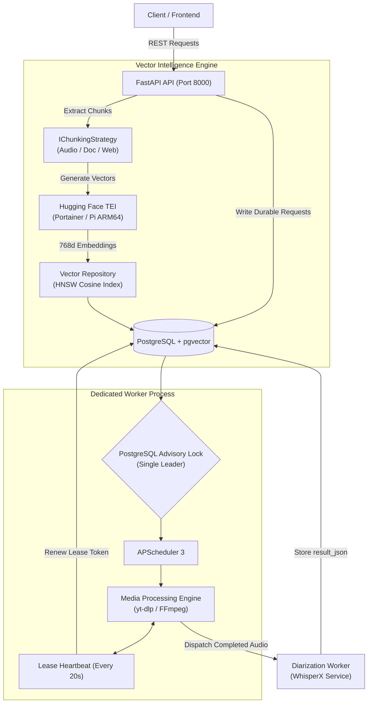
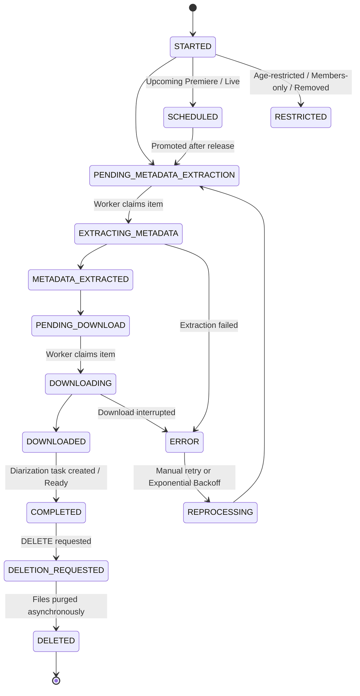

<p align="center">
  
</p>

<p align="center">
  <a href="https://www.python.org/"></a>
  <a href="https://fastapi.tiangolo.com/"></a>
  <a href="https://www.postgresql.org/"></a>
  <a href="https://huggingface.co/docs/text-embeddings-inference"></a>
  <a href="https://docs.astral.sh/uv/"></a>
  <a href="https://github.com/yt-dlp/yt-dlp"></a>
  <a href="https://docs.docker.com/"></a>
</p>

---

<p align="center">
  
</p>

<h1 align="center">SignalCatcher</h1>

<p align="center">
  <strong>Automated Video Capture, Speech Transcription, Speaker Diarization, Polymorphic Vectorization & Semantic Search</strong>
</p>

**SignalCatcher** is an automated video capture, speech transcription, speaker diarization, and content intelligence platform. It continuously monitors YouTube channels and playlists, extracts metadata, downloads high-fidelity media, coordinates AI diarization with WhisperX, and indexes content into an enterprise-grade vector database using **PostgreSQL (`pgvector`)** and **Hugging Face Text Embeddings Inference (TEI)** for high-precision semantic retrieval and RAG.

Engineered with **FastAPI**, **SQLAlchemy 2.0**, **PostgreSQL + pgvector**, **APScheduler**, and **yt-dlp**, SignalCatcher uses an enterprise-grade concurrency model featuring PostgreSQL advisory locks, lease-based task reservations, and resilient exponential backoff recovery.

---

## 📑 Table of Contents

- [Key Features](#-key-features)
- [Architecture & Design](#-architecture--design)
  - [Clean Architecture & Module Layout](#clean-architecture--module-layout)
  - [Distributed Concurrency & Locking](#distributed-concurrency--locking)
  - [Polymorphic Vector Search & Embeddings Engine](#polymorphic-vector-search--embeddings-engine)
- [Content Lifecycle & State Machine](#-content-lifecycle--state-machine)
- [Getting Started](#-getting-started)
  - [Prerequisites](#prerequisites)
  - [Local Installation with uv](#local-installation-with-uv)
  - [Running the Application](#running-the-application)
- [Vector Search & TEI Deployment](#-vector-search--tei-deployment)
  - [PostgreSQL with pgvector](#postgresql-with-pgvector)
  - [Hugging Face TEI on Portainer / Docker](#hugging-face-tei-on-portainer--docker)
  - [Raspberry Pi (ARM64) Deployment](#raspberry-pi-arm64-deployment)
- [Docker & Production Deployment](#-docker--production-deployment)
- [Scheduled Worker Jobs](#-scheduled-worker-jobs)
- [API Reference](#-api-reference)
  - [Health & Telemetry](#health--telemetry)
  - [YouTube Content & Channels](#youtube-content--channels)
  - [Diarization & Speech Intelligence](#diarization--speech-intelligence)
  - [Vectorization & Semantic Search](#vectorization--semantic-search)
- [Configuration Reference](#-configuration-reference)
- [Maintenance CLI & Diagnostics](#-maintenance-cli--diagnostics)
- [Code Quality & Testing](#-code-quality--testing)
- [Frontend Integration](#-frontend-integration)
- [License](#-license)

---

## ✨ Key Features

- **Automated YouTube Monitoring:** Track channels and playlists with configurable polling schedules via yt-dlp.
- **Robust Two-Process Architecture:** Independent, horizontally-scalable FastAPI REST API and a dedicated APScheduler background worker.
- **Fault-Tolerant Media Processing:** Lease-based content reservations (`SELECT FOR UPDATE SKIP LOCKED`), automatic renewal heartbeats, and safe recovery of interrupted downloads.
- **AI Diarization & Transcription Pipeline:** Dispatches completed media to WhisperX-powered diarization workers for speech transcription, word-level alignment, and speaker identification.
- **Polymorphic Vectorization & Semantic Search:** Universal `vector_chunks` repository with HNSW cosine indexing (`pgvector`), capable of embedding audio transcripts, documents (PDF/TXT/MD), and scraped websites with rich JSONB metadata.
- **Hugging Face TEI Integration:** Sub-millisecond vector embeddings using Rust-powered Hugging Face Text Embeddings Inference (`intfloat/multilingual-e5-base`), supporting x86-64 and Raspberry Pi ARM64.
- **Direct Playback Deep Links:** Semantic search matches return exact spoken intervals with timestamped YouTube links (`https://youtube.com/watch?v=...&t=...s`).
- **Resilient Error Classification:** Automatic detection of age restrictions, members-only content, private videos, and copyright notices with exponential backoff retries.
- **Safe Asynchronous Deletion:** Path-confined file purging that guarantees zero filesystem leaks while keeping records consistent.
- **Full Operational Telemetry:** Built-in health checks (`/status`, `/ready`), queue metrics (`/metrics`), and vector cluster diagnostics.

---

## 🏗️ Architecture & Design

### Clean Architecture & Module Layout

SignalCatcher strictly implements **Clean Architecture (DDD)** principles. Business rules remain completely isolated from databases, HTTP frameworks, and external tools:

```
src/
├── core/                        # Cross-cutting concerns (config, db, telemetry, logging)
│   ├── config/                  # Pydantic Settings and environment validation
│   ├── database/                # SQLAlchemy session & engine lifecycle management
│   └── telemetry/               # Metrics collection and health monitors
└── modules/
    ├── youtube/                 # YouTube ingestion, metadata & download module
    │   ├── domain/              # Entities, value objects, domain enums & repository interfaces
    │   ├── application/         # Use cases, DTOs, orchestrators, and mappers
    │   ├── infrastructure/      # Concrete SQLAlchemy repos, yt-dlp adapters, notifications
    │   └── presentation/        # FastAPI routers, request schemas & APScheduler definitions
    ├── diarization/             # Speaker diarization & AI transcription module
    │   ├── domain/              # Task entities, states, and interfaces
    │   ├── application/         # Dispatchers, retry handlers, status sync
    │   ├── infrastructure/      # HTTP client to WhisperX worker, task repositories
    │   └── presentation/        # FastAPI diarization endpoints
    └── vectorization/           # Polymorphic vector storage, embeddings & semantic search
        ├── domain/              # VectorChunkEntity, SemanticSearchResultEntity, SourceType enum
        │   └── interfaces/      # IChunkRepository, IEmbeddingService, IChunkingStrategy
        ├── application/         # VectorizeDiarizationUseCase, SemanticSearchUseCase, DTOs
        ├── infrastructure/      # VectorChunkModel (pgvector), TeiEmbeddingService, strategies
        └── presentation/        # FastAPI semantic search & vectorization routes
```

### Distributed Concurrency & Locking

> [!IMPORTANT]
> The API **never** starts an in-process scheduler or processes media work with FastAPI `BackgroundTasks`. The API and the worker run as separate OS processes.



### Polymorphic Vector Search & Embeddings Engine

SignalCatcher stores all vectorized knowledge in a unified `vector_chunks` table:

* **Source Polymorphism:** Handled via `SourceType` (`YOUTUBE_TRANSCRIPT`, `DOCUMENT`, `WEBSITE`, `CUSTOM`).
* **Chunking Strategies:** Implemented via Strategy Pattern:
  * `AudioTranscriptChunkingStrategy`: Slices WhisperX dialogues into coherent time windows (default 45s with 10s overlap) while preserving speaker identifiers (`SPEAKER_00`, `SPEAKER_01`) and start/end timestamps.
  * `DocumentTextChunkingStrategy`: Word/token windowing for long-form texts, PDFs, and Markdown documentation.
* **Metadata Schema (JSONB):** Adapts seamlessly to any media type without requiring schema migrations.

---

## 🔄 Content Lifecycle & State Machine

Every ingested video progresses through a deterministic, auditable state machine:



---

## 🚀 Getting Started

### Prerequisites

- **Python:** 3.10 or newer (3.12 recommended)
- **uv:** Ultra-fast Python package installer (`pip install uv` or `curl -LsSf https://astral.sh/uv/install.sh | sh`)
- **PostgreSQL:** 16+ with `pgvector` enabled (image `pgvector/pgvector:pg16` recommended)
- **FFmpeg:** Installed and accessible on system `PATH`
- **Hugging Face TEI (Optional but recommended):** For local/self-hosted vector embeddings

### Local Installation with `uv`

1. **Clone the repository:**
   ```sh
   git clone https://github.com/your-org/SignalCatcher.git
   cd SignalCatcher
   ```

2. **Configure environment variables:**
   ```sh
   cp .env.example .env
   ```
   Edit `.env` and configure your database, download path, and TEI URL:
   ```dotenv
   POSTGRES_USER=postgres
   POSTGRES_PASSWORD=your_secure_password
   POSTGRES_HOST=localhost
   POSTGRES_PORT=5432
   POSTGRES_DATABASE=signalcatcher
   DOWNLOAD_YOUTUBE_PATH=./youtube
   TEI_API_URL=http://localhost:8080
   ```

3. **Install dependencies and run migrations:**
   ```sh
   uv sync --frozen
   uv run alembic upgrade head
   ```

### Running the Application

Start the worker and API in separate terminal tabs:

**Terminal 1 — Dedicated Worker:**
```sh
uv run python worker.py
```

**Terminal 2 — FastAPI Web Server:**
```sh
uv run uvicorn main:app --host 127.0.0.1 --port 8000 --reload
```

- **Interactive API Documentation:** Available at [http://127.0.0.1:8000/docs](http://127.0.0.1:8000/docs) (Swagger UI) and `/redoc`.
- **Readiness Check:** [http://127.0.0.1:8000/ready](http://127.0.0.1:8000/ready) validates database connectivity and worker heartbeat.

---

## 🧠 Vector Search & TEI Deployment

### PostgreSQL with pgvector

Ensure your PostgreSQL container runs the official `pgvector` image so the `vector` extension and `HNSW` indexes are supported:

```yaml
services:
  db:
    image: pgvector/pgvector:pg16
    restart: unless-stopped
    environment:
      POSTGRES_USER: ${POSTGRES_USER:-signalcatcher}
      POSTGRES_PASSWORD: ${POSTGRES_PASSWORD:-secret}
      POSTGRES_DB: ${POSTGRES_DATABASE:-signalcatcher}
    volumes:
      - postgres_vector_data:/var/lib/postgresql/data
    ports:
      - "5432:5432"
```

### Hugging Face TEI on Portainer / Docker

Deploy a Portainer stack using the optimized Hugging Face Text Embeddings Inference engine:

```yaml
version: "3.8"

services:
  tei:
    image: ghcr.io/huggingface/text-embeddings-inference:cpu-1.5
    container_name: signalcatcher_tei
    restart: unless-stopped
    command:
      - "--model-id"
      - "intfloat/multilingual-e5-base"
      - "--port"
      - "80"
    ports:
      - "8080:80"
    volumes:
      - tei_cache:/data
```

### Raspberry Pi (ARM64) Deployment

When hosting the TEI inference service on an ARM64 server or **Raspberry Pi (4 or 5 with 8 GB RAM)**, use the official ARM64 image tag:

```yaml
version: "3.8"

services:
  tei:
    image: ghcr.io/huggingface/text-embeddings-inference:cpu-arm64-latest
    container_name: signalcatcher_tei
    restart: unless-stopped
    command:
      - "--model-id"
      - "intfloat/multilingual-e5-base"
      - "--port"
      - "80"
      - "--max-client-batch-size"
      - "16"
      - "--max-batch-tokens"
      - "8192"
    ports:
      - "8080:80"
    volumes:
      - tei_cache:/data
```

---

## 🐳 Docker & Production Deployment

SignalCatcher provides production-ready Docker Compose configurations separating migrations, API, and worker:

```sh
docker compose up --build -d
```

| Service | Role | Ports / Healthcheck |
| :--- | :--- | :--- |
| `migrate` | One-shot Alembic migration runner | Runs before API and worker start |
| `app` | Scalable FastAPI application server | Exposed on port `5001` (internal `8000`) |
| `worker` | Scheduler and media extraction runner | Healthcheck verifies heartbeat timestamp in PostgreSQL |

---

## ⏱️ Scheduled Worker Jobs

APScheduler manages background jobs with isolated execution lanes:

| Job ID | Frequency | Description |
| :--- | :--- | :--- |
| `youtube_monitor_channels` | Every 30 min | Discovers new videos from monitored channels |
| `youtube_extract_and_download` | Every 15 min | Processes metadata queue followed by pending downloads |
| `youtube_process_errors` | Every 30 min | Evaluates backoff timers and re-queues eligible errors |
| `youtube_promote_scheduled` | Every 30 min | Promotes released premieres and livestreams to download |
| `youtube_delete_contents` | Every 1 min | Asynchronously removes filesystem assets for deleted media |
| `youtube_extract_metadata` | Manual / Trigger | On-demand metadata extraction lane |
| `youtube_download_videos` | Manual / Trigger | On-demand video download lane |

---

## 🔌 API Reference

### Health & Telemetry

| Method | Endpoint | Description |
| :--- | :--- | :--- |
| `GET` | `/status` | Basic API liveness check |
| `GET` | `/ready` | Deep readiness check: DB connectivity and fresh worker heartbeat |
| `GET` | `/metrics` | Operational JSON telemetry (queue sizes, retry counts, job runtimes) |

### YouTube Content & Channels

| Method | Endpoint | Description |
| :--- | :--- | :--- |
| `GET` | `/api/youtube/channels` | Retrieve all registered YouTube channels |
| `POST` | `/api/youtube/monitored_channels` | Register a new channel for automated polling |
| `GET` | `/api/youtube/monitored_channels` | List all monitored channels and active schedules |
| `PATCH` | `/api/youtube/monitored_channels/{id}/status` | Enable or pause channel monitoring |
| `POST` | `/api/youtube/content` | Ingest a single video by URL / ID |
| `GET` | `/api/youtube/content` | List paginated media with filters, status, and metadata |
| `POST` | `/api/youtube/playlist` | Ingest all videos from a YouTube playlist |
| `GET` | `/api/youtube/content/status-count` | Aggregate count of videos per pipeline state |
| `DELETE` | `/api/youtube/content/{external_id}` | Request asynchronous physical file deletion |

### Diarization & Speech Intelligence

| Method | Endpoint | Description |
| :--- | :--- | :--- |
| `POST` | `/api/diarization/youtube/{external_id}` | Create an AI speaker diarization task for completed content |
| `GET` | `/api/diarization/list` | List diarization tasks with status and progress |
| `POST` | `/api/diarization/{id}/reprocess` | Requeue an interrupted or failed diarization task |
| `POST` | `/api/diarization/{id}/cancel` | Cancel an in-flight diarization task |

### Vectorization & Semantic Search

| Method | Endpoint | Description |
| :--- | :--- | :--- |
| `POST` | `/api/search/semantic` | Natural language semantic search across indexed video transcripts and documents |
| `POST` | `/api/vectorization/diarization/{id}` | Generate and persist vector embeddings for a specific diarization task |
| `POST` | `/api/vectorization/batch` | Batch-vectorize all un-indexed completed diarization tasks |
| `GET` | `/api/vectorization/stats` | Telemetry for indexed chunks, total sources, and TEI cluster health |
| `GET` | `/api/vectorization/status/{id}` | Inspect indexation status and chunk count for a specific diarization task |

---

## ⚙️ Configuration Reference

All settings are configured via environment variables and validated through Pydantic Settings (`src/core/config/settings.py`):

| Variable | Default | Purpose |
| :--- | :--- | :--- |
| `POSTGRES_USER` | *Required* | Database username |
| `POSTGRES_PASSWORD` | *Required* | Database password |
| `POSTGRES_HOST` | `localhost` | PostgreSQL host address |
| `POSTGRES_PORT` | `5432` | PostgreSQL port |
| `POSTGRES_DATABASE` | `signalcatcher` | Database name |
| `DOWNLOAD_YOUTUBE_PATH` | *Required* | Filesystem root for media downloads |
| `CORS_ALLOWED_ORIGINS` | `http://localhost:3000,http://localhost:5173` | Allowed CORS origins for browser clients |
| `PROCESSING_LEASE_SECONDS`| `300` | Lease duration before an unrenewed reservation expires |
| `MAX_PROCESSING_ATTEMPTS` | `5` | Maximum retry attempts per item |
| `RETRY_BASE_SECONDS` | `300` | Initial exponential backoff delay (5 minutes) |
| `RETRY_MAX_SECONDS` | `86400` | Maximum exponential backoff cap (24 hours) |
| `WORKER_HEARTBEAT_MAX_AGE`| `60` | Max age in seconds before worker is marked stale by `/ready` |
| `DIARIZATION_API_URL` | `http://localhost:8001` | Base URL of the WhisperX Diarization service |
| `TEI_API_URL` | `http://localhost:8080` | Base URL of Hugging Face Text Embeddings Inference (Portainer/Pi) |
| `TEI_TIMEOUT_SECONDS` | `30.0` | HTTP timeout for embedding requests |
| `EMBEDDING_BATCH_SIZE` | `32` | Number of chunks sent per embedding batch |
| `EMBEDDING_DIMENSION` | `768` | Vector dimension (`768` for multilingual-e5-base) |
| `CHUNK_TARGET_SECONDS` | `45.0` | Target time window for spoken dialogue chunks |
| `CHUNK_OVERLAP_SECONDS` | `10.0` | Sliding window overlap between consecutive chunks |

---

## 🛠️ Maintenance CLI & Diagnostics

```sh
# Safely queue a video for physical deletion and status update
uv run python -m script.delete_content <VIDEO_EXTERNAL_ID>

# Immediately re-queue all eligible error records
uv run python -m script.reprocess_errors

# Reset orphaned or stuck processing leases that lost worker ownership
uv run python -m script.reset_stuck_states
```

---

## 🧪 Code Quality & Testing

```sh
# Linting with Ruff
uv run ruff check .

# Static type analysis with Mypy
uv run mypy

# Run full unit and integration test suite
uv run python -m unittest discover -s tests
```

---

## 💻 Frontend Integration

SignalCatcher pairs with **SignalCatcherFrontend**, a modern React 19 dashboard built with **Vite**, **TailwindCSS v4**, and **shadcn/ui**:

- **Video Ingestion & Tracking:** Live channel monitoring and pipeline tracking.
- **Audio & Diarization Viewer:** Interactive transcripts with speaker-assigned dialogue turns.
- **Semantic Search Studio:** Natural language search bar, similarity threshold slider, and direct **Jump to Timestamp** playback buttons.

Set `VITE_API_BASE_URL=http://localhost:8000` in the frontend `.env` to connect.

---

## 📄 License

This project is maintained for private and internal use. Consult the author for licensing and distribution details.
